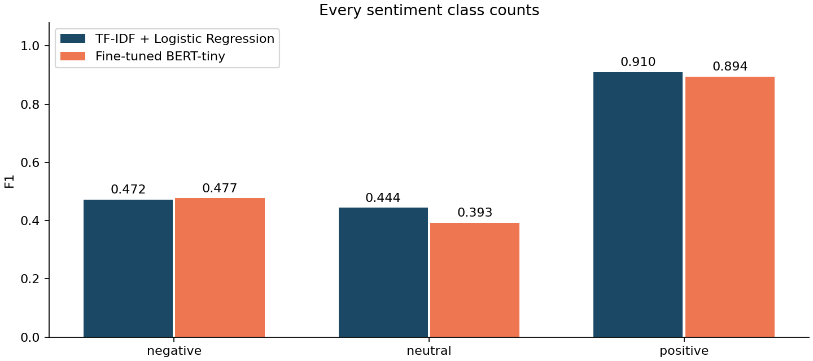
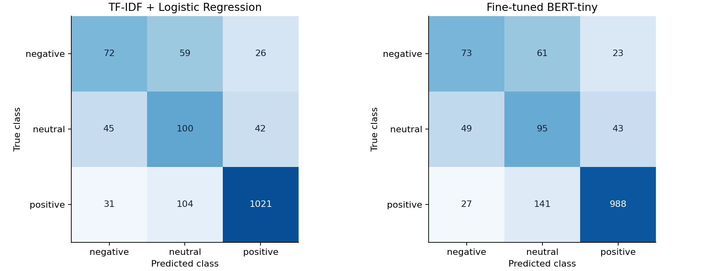
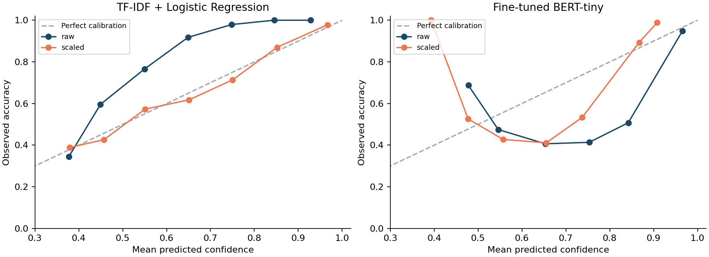

# Product review sentiment classifier

Executed comparison · 10,000 real reviews · Three sentiment classes · CPU training and inference

**Test macro-F1 winner: TF-IDF + Logistic Regression. Recommended deployment: TF-IDF + Logistic Regression.** Both models were fitted to the same 7,000 training reviews, selected on the same 1,500 validation reviews, and evaluated on the same 1,500 untouched test reviews.

> The comparison is genuine: the submission includes trained weights, original inputs, saved split IDs, row-level probabilities, measured resource costs, and tests that reject mismatched splits. No reported metric is a placeholder.

## 1. Data and labeling

Source: nicapotato's [Women's E-Commerce Clothing Reviews](https://www.kaggle.com/datasets/nicapotato/womens-ecommerce-clothing-reviews), CC0. Review body is the only input; stars produce the target. 1–2 stars = negative, 3 = neutral, 4–5 = positive. Neutral is an average-rating proxy and often expresses mixed sentiment, rather than purely factual language.

Cleaning started with 23,486 source rows: 845 missing/empty bodies, 0 invalid ratings, 7 redundant normalized duplicates and 0 rows in contradictory duplicate groups were removed. 22,634 unique eligible reviews remained. A stratified random sample of 10,000 preserves natural label prevalence; no test-set balancing was applied.

| Class | Sample n | Share | Train | Validation | Test | Train weight |
| --- | --- | --- | --- | --- | --- | --- |
| negative | 1047 | 10.47% | 733 | 157 | 157 | 3.183 |
| neutral | 1247 | 12.47% | 873 | 187 | 187 | 2.673 |
| positive | 7706 | 77.06% | 5394 | 1156 | 1156 | 0.433 |

The majority-to-minority ratio is 7.36:1. Always predicting positive gives 77.07% test accuracy but only 0.2902 macro F1. This is why accuracy alone would mislead.

Both models use inverse-frequency weights computed only on their training labels: w(c) = N / (K × count(c)). Logistic Regression uses class_weight='balanced'; BERT uses the same weights in cross-entropy. This increases minority-class influence without changing test prevalence. No resampling was used.

## 2. Preprocessing and model choices

Common cleaning decodes HTML entities, removes HTML tags and zero-width characters, applies Unicode NFKC normalization and collapses whitespace. Negation, punctuation, sentence order and sentiment-bearing words are preserved. Exact casefolded cleaned text is deduplicated before splitting; conflicting duplicate labels are excluded. Ratings, recommendation flags, age, title, clothing ID and product categories are never features.

**Classical baseline:** scikit-learn TF-IDF unigrams/bigrams, 40,000-feature cap, min_df=2, max_df=0.99, sublinear term frequency, followed by class-weighted multinomial Logistic Regression. The default word tokenizer drops punctuation and one-letter tokens. Vocabulary and IDF are learned only on train. C ∈ {0.5, 2, 8} is selected by validation macro F1.

**Transformer:** Hugging Face [prajjwal1/bert-tiny](https://huggingface.co/prajjwal1/bert-tiny), pinned revision `6f75de8b60a9f8a2fdf7b69cbd86d9e64bcb3837`. This is a language-pretrained two-layer encoder with hidden size 128. A new three-class head and all encoder parameters were actually fine-tuned here; this is not zero-shot sentiment inference. The resulting model has 4,386,307 parameters. Uncased WordPiece tokenization, dynamic padding, maximum 192 tokens, weighted cross-entropy, AdamW lr=0.0003, weight decay=0.01, batch size 32, 10% linear warmup and gradient clipping at 1.0 were used for five epochs. The best validation macro-F1 checkpoint is kept (epoch 5). 0.00% of training reviews exceed 192 tokens and are right-truncated.

The compact transformer makes the complete experiment reproducible on a CPU. No GPU, paid API, hosted inference service or full-size BERT fine-tuning is required. This compares two practical pipelines with their stated search budgets; it does not isolate architecture under equal optimization budgets.

## 3. Identical-split audit

Seed 42; stratified 70/15/15 train/validation/test after cleaning and sampling. The shared `data/splits.json` is the sole source of membership. Every training run records the SHA-256 of that file, the dataset snapshot and ordered IDs. Evaluation rechecks them, and report generation checks row-level ID and gold-label equality. A mismatch raises an error and rejects the comparison. Test text is used only for predictions, benchmark timing and post-evaluation analysis.

| Partition | Rows | SHA-256 of ordered IDs (both models) |
| --- | --- | --- |
| train | 7000 | `425bed305972bfa887f5ed9d95137eb026a0f804c6d3c899819f2fd6b91a7762` |
| validation | 1500 | `b5ab50308845c41f0082d2fe48fd68096d0f8b84d27f44393bdff281add56df1` |
| test | 1500 | `9be000b31555080298bec49eb0f45511eaae05435f170abb4042cc50c78f1d15` |

Snapshot SHA-256: `09d81aa55a19f8b2f6c696625abe3b4ed289c1c23a1b1250ac9aa46509b531fd`. Raw CSV SHA-256: `bd93cc515747ad1f87b8bc863c9e40da758509e6db6506a96d06976e61e36ee0`.

The baseline's C and transformer's checkpoint are selected only on validation. Scalar confidence temperatures are also fitted only on validation. The test set does not determine fitting, hyperparameters, temperature or the CLI's model choice. Neither model is refitted on train+validation.

## 4. Held-out results

| Model | Validation macro F1 | Test accuracy | Test macro F1 | Test weighted F1 |
| --- | --- | --- | --- | --- |
| TF-IDF + Logistic Regression | 0.6273 | 0.7953 | 0.6087 | 0.8058 |
| Fine-tuned BERT-tiny | 0.6014 | 0.7707 | 0.5879 | 0.7879 |

| Model | Class | Precision | Recall | F1 | Test support |
| --- | --- | --- | --- | --- | --- |
| TF-IDF + Logistic Regression | negative | 0.4865 | 0.4586 | 0.4721 | 157 |
| TF-IDF + Logistic Regression | neutral | 0.3802 | 0.5348 | 0.4444 | 187 |
| TF-IDF + Logistic Regression | positive | 0.9376 | 0.8832 | 0.9096 | 1156 |
| Fine-tuned BERT-tiny | negative | 0.4899 | 0.4650 | 0.4771 | 157 |
| Fine-tuned BERT-tiny | neutral | 0.3199 | 0.5080 | 0.3926 | 187 |
| Fine-tuned BERT-tiny | positive | 0.9374 | 0.8547 | 0.8941 | 1156 |





Transformer minus baseline macro F1 = -0.0208; paired stratified bootstrap 95% percentile interval [-0.0592, +0.0153], 1,000 resamples, seed 2026. The interval reflects resampling uncertainty on these fixed predictions, not variability across training seeds. Baseline-only correct: 133; transformer-only correct: 96; exact McNemar p=0.01717 (accuracy disagreement, not a test of macro F1).

The interval includes zero, so this test does not establish a clear population-level macro-F1 advantage; cost and validation evidence still support the practical choice.

## 5. Measured simplicity and resource costs

| Model | Train/selection sec | Train RSS MiB | Eval RSS MiB | Saved MiB | p50 ms/review | p95 ms/review | Batch reviews/sec |
| --- | --- | --- | --- | --- | --- | --- | --- |
| TF-IDF + Logistic Regression | 5.3 | 228.4 | 175.4 | 1.22 | 0.559 | 0.663 | 13776 |
| Fine-tuned BERT-tiny | 205.1 | 866.5 | 480.3 | 17.64 | 2.007 | 2.734 | 955 |

CPU only, four intra-op/BLAS threads. Training costs include all three baseline C fits or all five transformer epochs and validation, plus saving the selected model; they exclude dependency installation/downloads and initial imports. RSS is sampled process resident memory, including loaded libraries, in separate model processes; it is not GPU VRAM or a precise tensor allocation measure. Saved sizes are compressed baseline weights versus transformer safetensors/tokenizer/config; metadata and calibration JSON are excluded.

CPU only, 4 intra-op/BLAS threads, three warmups, serial request batch size 1, identical first 128 ordered test reviews repeated three times. Includes tokenization/vectorization and forward pass; excludes imports, model load, disk I/O, queue/network overhead and temperature softmax. Batch throughput uses all 128 inputs (transformer internal batches 32).

These are measurements on this Windows laptop, not a production SLA. First-load times and the complete environment are in the JSON artifacts. Imports/loading, concurrency, token lengths and deployment hardware can substantially change real service latency.

## 6. Error analysis

The cases below are actual held-out misclassifications, selected after evaluation to illustrate failures rather than to estimate their prevalence. Every hypothesis is an interpretation of the text, not proof about hidden model reasoning. Full source bodies and predictions are included for inspection.

### TF-IDF + Logistic Regression · clothing:2258 · Rating proxy versus textual sentiment

Gold: **neutral** (3 stars). Predicted: **negative**. Calibrated confidence: 0.983.

> Hangs terribly off the chest. tent-like. looks maternity. no thanks.

Hypothesis: The body is almost entirely critical: 'hangs terribly', 'tent-like' and 'no thanks' all support negative language, yet the source gives three stars. The model may be following the words reasonably while failing the rating-derived neutral target. The text alone does not explain the reviewer's average rating. This illustrates weak-label ambiguity rather than establishing a wrong source annotation.

### TF-IDF + Logistic Regression · clothing:17768 · Mixed sentiment and aspect trade-off

Gold: **neutral** (3 stars). Predicted: **positive**. Calibrated confidence: 0.972.

> Love these pants. ordered in petite .,love style, great fit but so long . keeping but have to get hemmed 2 1/2 inches. decided to order the black & green as well.

Hypothesis: Repeated positive phrases about love, style and fit, plus ordering more colors, can outweigh the local 'but so long' complaint in a bag of weighted n-grams. The reviewer apparently penalizes the need for hemming enough to award three stars. TF-IDF does not explicitly represent how an alteration cost changes the overall judgment.

### TF-IDF + Logistic Regression · clothing:8786 · Negation and cumulative dissatisfaction

Gold: **negative** (2 stars). Predicted: **neutral**. Calibrated confidence: 0.968.

> I loved the look of this sweater on-line, but it just didn't work for me. the fit wasn't good enough. the style okay. the color fine. the feel, scratchy. overall, it did not work for my body.

Hypothesis: The opening 'loved the look' and mild descriptors 'okay' and 'fine' coexist with several negatives about fit, scratchiness and not working for the body. Local n-grams can represent some negation but may average these aspects into neutral instead of recognizing the cumulative rejection reflected in two stars. The final negative judgment should receive more weight than isolated mild praise.

### TF-IDF + Logistic Regression · clothing:19099 · Historical praise versus current quality failure

Gold: **negative** (2 stars). Predicted: **positive**. Calibrated confidence: 0.901.

> I've been wearing these shorts for years, i work outside and it was great to have comfortable jean shorts that were just the perfect length. the fabric quality on these shorts (and many many other retailer items) has gone down. sure, they're great when you try them on in the store..soft, comfortable, flattering, but when these are worn for a day they get so stretched out that i feel like i need a belt to keep them on. i wore these several times, sat down on a relatively smooth concrete wall, and a

Hypothesis: Much of the vocabulary praises previous comfort, length and the store try-on experience. The complaint is a change over time: quality has declined and the shorts stretch during wear. Unordered n-grams may give historical praise too much influence. The provided source body also ends abruptly, so the model lacks any later conclusion; no missing continuation is assumed here.

### TF-IDF + Logistic Regression · clothing:3508 · Personal fit criticism despite positive stars

Gold: **positive** (4 stars). Predicted: **neutral**. Calibrated confidence: 0.932.

> Well first off i knew a jumpsuit was going to be a gamble for me- i have a long torso at 6 feet , but i just loved the print and the style and typically all things sactuary so i was willing to risk it. sadly the torso length was an issue and it seemed to run small to me-i ordered a small which usually would fit fine, but ended up pulling across my hips and with the patten being what it is... well on me it just wasn't flattering or comfortable.

Hypothesis: The reviewer praises the print and style but then describes a short torso, pulling across the hips and an unflattering, uncomfortable fit. That wording supports mixed or negative personal experience, although the rating is four stars. The model may conflate poor fit for this individual with a low overall product rating, which cannot be resolved confidently from this body alone.

### Fine-tuned BERT-tiny · clothing:5291 · Conditional praise and negation scope

Gold: **negative** (2 stars). Predicted: **positive**. Calibrated confidence: 0.897.

> This a great skirt for someone with a straight or boyish figure. this skirt does not accommodate a curvy figure - small waist, feminine hips.

Hypothesis: 'Great skirt' applies specifically to someone with a straight figure; the following sentence says it does not accommodate a curvy figure. The model may overweight the general praise and attractive descriptors rather than binding them to the condition and the reviewer's negative fit assessment. This short review is not plausibly explained by a long-input truncation issue.

### Fine-tuned BERT-tiny · clothing:3009 · Warning obscured by recalled positive experience

Gold: **neutral** (3 stars). Predicted: **positive**. Calibrated confidence: 0.907.

> Let me start off by saying i never write reviews, but feel compelled to so that no one else gets swindled into buying this beautiful one-time wear piece. i absolutely fell in love with this shirt when i bought it in the fall in black... perfect basic to wear under my new draped open vest from retailer! and perfect fit! i'm long torso-ed and long armed and always have trouble with fit. this being kind of oversized was just loose enough and long enough i could actually feel comfortable wearing it wi

Hypothesis: The opening warns others against a 'one-time wear' item and being 'swindled', but much of the remaining body enthusiastically recounts initial love and a perfect fit. Tiny BERT may fail to connect the warning to the later remembered praise. The source ends mid-word, limiting evidence about the eventual failure; this is an incomplete supplied review, not proof that the model's token cutoff removed the answer.

### Fine-tuned BERT-tiny · clothing:5190 · Unobserved reason for an average rating

Gold: **neutral** (3 stars). Predicted: **positive**. Calibrated confidence: 0.910.

> I bought this sweater online and was surprised by how thick and fluffy it is. this is a warm and cozy sweater, more bulky than oversized. pattern has a comic book-style art look. it has raglan sleeves and a boxy cut and narrows a bit at the waist. cute, warm sweater for winter--wore with an undershirt.

Hypothesis: Warm, cozy and cute are positive cues, while bulky and boxy can be either descriptive or critical. The three-star rating may reflect dissatisfaction with thickness or expectations that are only implied in the text. A language-pretrained model fine-tuned on limited rating labels can still miss this understated evaluative meaning and predict positive with excessive confidence.

### Fine-tuned BERT-tiny · clothing:21998 · Practical caveat versus overall endorsement

Gold: **positive** (4 stars). Predicted: **negative**. Calibrated confidence: 0.833.

> I really love the look and feel of this top, perhaps this was mentioned in previous reviews, but it is unlined, which i hadn't realized when i ordered it. so the eyelet details are will expose skin unless you wear a cami underneath.

Hypothesis: The reviewer explicitly loves the look and feel, then explains that the unlined eyelet fabric needs an underlayer. The model may interpret exposure and lack of lining as a decisive defect instead of a practical caveat within a four-star endorsement. This suggests difficulty weighting aspect-level information against the review's overall positive stance.

### Fine-tuned BERT-tiny · clothing:1163 · Service complaint versus product rating

Gold: **positive** (4 stars). Predicted: **negative**. Calibrated confidence: 0.836.

> I really wanted this. they had two size small in my local retailer, both were damaged. so disappointing. i don't want to pay shipping for one that hopefully isn't damaged:( in the last year i've had multiple quality control issues with retailer. makes me gun shy. not sure i'm getting what i pay for anymore.

Hypothesis: The language is consistently disappointed about damaged store stock, shipping and retailer quality control, yet the product receives four stars. The model appears to capture negative sentiment in the body while the target may represent a separate judgment of the desired item. Product-versus-service aspect separation and rating-proxy ambiguity both offer explanations; the text does not prove which one caused the error.

### Systematic weakness check

| Model | Subset | Test n | Error rate |
| --- | --- | --- | --- |
| TF-IDF + Logistic Regression | Neutral gold label | 187 | 46.52% |
| TF-IDF + Logistic Regression | Contains but/however/although/yet | 874 | 26.66% |
| TF-IDF + Logistic Regression | No such contrast cue | 626 | 11.82% |
| Fine-tuned BERT-tiny | Neutral gold label | 187 | 49.20% |
| Fine-tuned BERT-tiny | Contains but/however/although/yet | 874 | 29.29% |
| Fine-tuned BERT-tiny | No such contrast cue | 626 | 14.06% |

Average-rating/neutral reviews expose a recurring boundary problem: they can praise appearance while criticizing fit or value, while stars summarize a personal trade-off. TF-IDF bigrams capture local cues but cannot reliably weigh a long concession against the overall judgment. Tiny BERT has context but limited capacity/data and a 192-token cutoff. Contrast-cue error rates are descriptive and confounded by review difficulty and class mix; the cue itself is not demonstrated to cause errors. The manually reviewed cases and neutral-class metrics support the mixed-sentiment hypothesis, while sarcasm remains an unmeasured possibility.

## 7. Neutral-class ablation

Both models were also trained from scratch/from the same pretrained encoder as binary classifiers after removing only neutral rows from each saved partition. The original non-neutral row assignments are retained; the polar test IDs are identical across binary and three-class comparisons. Each binary transformer receives a new two-class head, five epochs and validation-only checkpoint selection. Class weights are recalculated on binary training data.

| Model | Polar test n | 3-way on polar accuracy | 3-way on polar F1 | Binary-trained accuracy | Binary-trained F1 |
| --- | --- | --- | --- | --- | --- |
| TF-IDF + Logistic Regression | 1313 | 0.8324 | 0.7404 | 0.9254 | 0.8177 |
| Fine-tuned BERT-tiny | 1313 | 0.8081 | 0.7400 | 0.9040 | 0.7850 |

On the same polar test rows, training the binary task changes macro F1 by +0.0773 for TF-IDF + Logistic Regression; +0.0450 for Fine-tuned BERT-tiny. Both binary-trained models score higher here: retaining a neutral output makes these polar decisions harder in this experiment, while enabling the system to represent average/mixed reviews.

For three-way-on-polar scores, a neutral prediction is counted as an error/false negative; macro F1 averages negative and positive. This isolates evaluation to the exact same polar examples. The ablation changes label space, training population, weights and task difficulty; its differences are not a causal estimate of the effect of adding neutral data alone. Binary scores cannot describe how well the system handles genuinely mixed reviews.

## 8. Out-of-domain Yelp test

1,000 real Yelp restaurant sentences (500 negative/500 positive) from [UCI Sentiment Labelled Sentences](https://archive.ics.uci.edu/dataset/331/sentiment+labelled+sentences), Kotzias (2015), [DOI](https://doi.org/10.24432/C57604), CC BY 4.0. These examples are never used for fitting, checkpoint selection or calibration. They differ in domain, length and label prevalence. They provide no neutral gold labels, so neutral recall/F1 cannot be assessed here.

| Model | 3-way exact accuracy | Polar macro F1 (neutral = error) | Neutral prediction rate | Forced-binary diagnostic F1 |
| --- | --- | --- | --- | --- |
| TF-IDF + Logistic Regression | 0.6320 | 0.6473 | 5.90% | 0.6620 |
| Fine-tuned BERT-tiny | 0.6620 | 0.6989 | 10.60% | 0.7222 |

The forced-binary diagnostic discards the neutral logit and chooses between negative and positive; it is explicitly a different decision rule and is not substituted for the main three-way classifier. Performance here cannot be compared directly to clothing accuracy because the target distribution and annotation process differ. Inspect `three_class_*.json` for per-class OOD precision/recall/F1 and confusion matrices.

On the Yelp polar test, BERT's macro F1 is 0.6989 versus 0.6473 for the baseline. The ranking reverses in this separate domain check, which limits any claim that the clothing winner generalizes best everywhere.

## 9. Confidence calibration

Temperature scaling fits one positive scalar T by minimizing unweighted validation negative log likelihood; test probabilities are softmax(logits/T). It does not alter the predicted class. Baseline logits are log(predict_proba); BERT logits are its raw head outputs. Calibration is not assumed to succeed: the table shows held-out raw and scaled results. ECE uses ten equal-width confidence bins; Brier is the mean sum of squared probability errors across classes (lower is better for all three scores).

| Model | Confidence | NLL | Brier | ECE (10 bins) | n confidence ≥0.8 | Accuracy at ≥0.8 |
| --- | --- | --- | --- | --- | --- | --- |
| TF-IDF + Logistic Regression | raw | 0.6244 | 0.3407 | 0.1859 | 246 | 100.00% |
| TF-IDF + Logistic Regression | scaled | 0.5045 | 0.2821 | 0.0203 | 869 | 94.94% |
| Fine-tuned BERT-tiny | raw | 0.6322 | 0.3403 | 0.1134 | 1151 | 87.14% |
| Fine-tuned BERT-tiny | scaled | 0.5731 | 0.3146 | 0.1079 | 941 | 95.32% |



Validation is reused for model selection and temperature fitting, so calibration quality may be optimistic; test is still untouched by fitting. A production system should reserve an independent calibration set and assess classwise calibration, particularly after prior/domain shift. Confidence is not a guarantee of correctness; empty bins are not plotted and small bins have high uncertainty.

## 10. Deployment verdict

**Deploy TF-IDF + Logistic Regression for CPU-only weekly reporting of 10,000 English apparel reviews.** The choice follows validation macro F1, preferring the baseline if within 0.005; this rule does not use test or Yelp outcomes. The test table is an independent check on that choice. The stated workload prioritizes minority-class visibility, easy reproducible retraining and low operating cost.

The selected model's test macro F1 is 0.6087, neutral F1 is 0.4444, CPU p50 is 0.559 ms/review, and saved artifact size is 1.22 MiB. These measured costs and class-level errors make the recommendation assessable, rather than assuming the transformer must win. The other model remains available through the same CLI.

Use calibrated probabilities to flag uncertain cases for review, validate any operational confidence threshold on a fresh sample, and report neutral separately in dashboards. A three-class sentiment model is not an urgency classifier: a real-time support-triage deployment needs support-ticket labels, urgency/recall targets and its own latency test. For a larger or more varied offline corpus, evaluate a stronger review-tuned transformer on a newly held-out set before changing the recommendation.

This recommendation is for human-reviewed aggregate reporting. With the measured negative/neutral F1 scores, neither model is ready for unattended per-review decisions requiring reliable minority-class recognition. Audit a fresh sample before operational use.

## 11. Reproduce and test live

Python 3.12 is recommended. All data, original pretrained weights and fitted models are bundled; inference and training run offline after package installation. From the project directory:

```powershell
python -m venv .venv
.venv\Scripts\Activate.ps1
python -m pip install -r requirements.txt
python -m sentiment.cli --text "Nice color, but the fit is just okay."
python -m sentiment.cli --model transformer --file examples/reviews.txt
python reproduce.py
python -m unittest discover -s tests -v
```

`python reproduce.py --evaluate-only` reuses the fitted models and regenerates predictions, calibration, timing, figures and reports. `python scripts/download_inputs.py` restores missing original inputs after checking their recorded hashes. Full retraining may have small numerical differences across OS/BLAS/PyTorch versions despite deterministic seeds; the saved split membership stays exact.

## 12. Scope and limitations

- Ratings are weak labels; three-star text is not always linguistically neutral. Error review cannot establish that the source rating is incorrect.

- The split is by review, not product or author. Exact normalized duplicates are removed, but near duplicates and shared products may remain; author IDs are unavailable. Product-held-out and temporal generalization are unmeasured.

- This is one seed and a 10,000-review sample. The bootstrap does not replace repeated training runs or a larger test of minority classes.

- Results concern a compact, actually fine-tuned BERT model. They do not establish that classical ML beats all transformers. Model size and tuning effort matter.

- The transformer truncates long inputs; inference exposes a truncated flag. The baseline sees the full review but loses global order. Neither pipeline explicitly handles sarcasm or aspect-level sentiment.

- Yelp checks domain and sentence-length shift, only for polar labels. It cannot establish three-class deployment quality on restaurants or support messages.

- CPU timing and sampled RSS are local measurements. Loading, service overhead, concurrency and GPU behavior require separate production benchmarks.

## 13. Requirement evidence

| Requirement | Evidence |
| --- | --- |
| ≥1,000 real labeled examples | 10,000 review snapshot; original 23,486-row CSV; data/splits.json provenance/hashes |
| Positive / negative / neutral | Three-star mapping, saved label config, live CLI |
| scikit-learn classical baseline | sentiment/experiment.py; fitted TF-IDF + Logistic Regression artifact |
| Hugging Face transformer | Actual BERT-tiny fine-tuning; safetensors weights and epoch/validation history |
| Identical train/test splits | One manifest; training/evaluation ID hashes; row-level audit tests |
| Per-class precision/recall/F1 | Section 4; reports/per_class_metrics.csv; full JSON reports |
| Class imbalance measured/handled | Section 1; train-only class weights for both models |
| ≥5 reviewed errors | Section 6; 10 actual errors, at least five per model, reports/error_reviews.json |
| Deployment recommendation | Section 10; measured accuracy/F1, latency, memory and size |
| Bonus: neutral ablation | Section 7; two separately trained binary models on the original polar row IDs |
| Bonus: out-of-domain | Section 8; 1,000 unseen real Yelp sentences, both models |
| Bonus: calibration | Section 9; validation-fitted temperature, test reliability/ECE/Brier/NLL |
| Bonus: live CLI | sentiment/cli.py; defaults to validation-selected recommended model |

## Sources

Dataset/model links are cited where used. Full source attribution, licenses, pretrained revision and implementation references are in [DATA_SOURCES.md](../DATA_SOURCES.md). Every table is computed from this project's model outputs.
